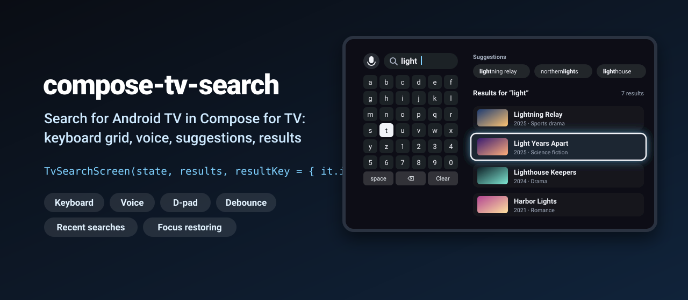
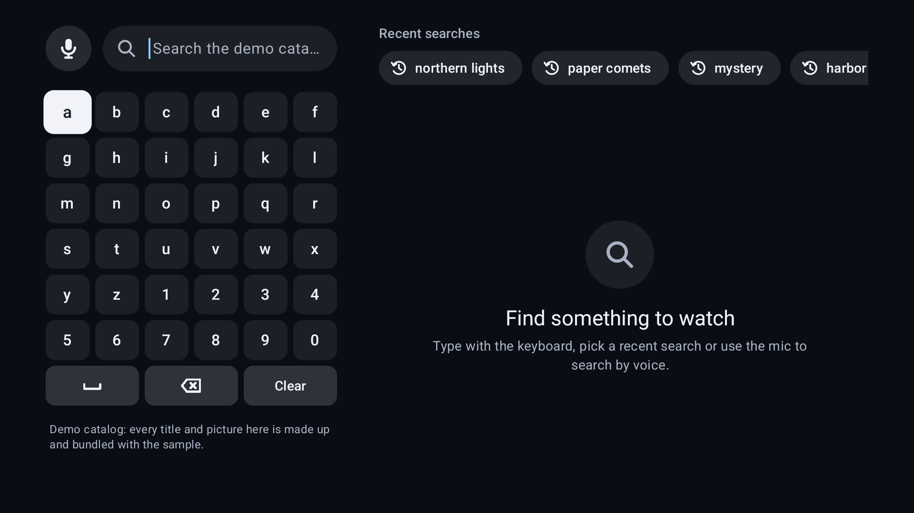
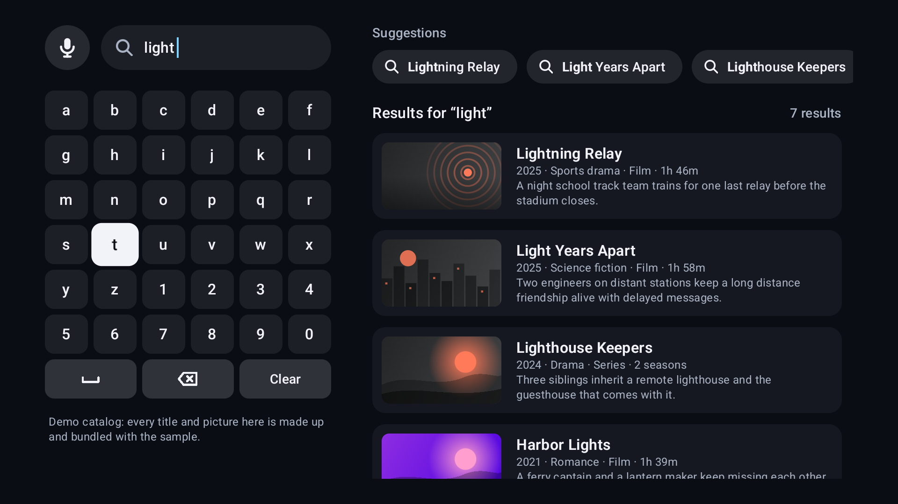
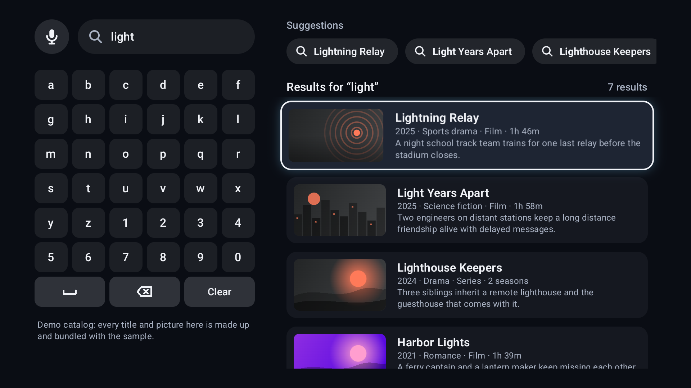

<p align="center">
  
</p>

<p align="center">
  <a href="https://github.com/halilozel1903/compose-tv-search/actions/workflows/ci.yml"></a>
  <a href="https://jitpack.io/#halilozel1903/compose-tv-search"></a>
  
  
  
  
  <a href="LICENSE"></a>
</p>

**compose-tv-search** is the search screen of a streaming app for Android TV, built with Compose for TV: an on-screen keyboard grid made for the D-pad, a voice search button, recent searches and suggestions, a debounced query, and focusable result rows or a grid. Focus comes back to the key or result you left when you move between the keyboard and the results. The keyboard, debounce, ranking and focus logic lives in a plain Kotlin module with unit tests.

```kotlin
val state = rememberTvSearchState()
val results = remember(state.debouncedQuery) { catalog.search(state.debouncedQuery) }

TvSearchScreen(
    state = state,
    results = results,
    resultKey = { it.id },
    voiceSearch = rememberVoiceSearchLauncher(state),
) { movie ->
    SearchResultRow(movie.title, onClick = { state.recordSearch(); open(movie) }, subtitle = movie.meta) {
        Poster(movie)
    }
}
```

## Screenshots

Captured from the sample app on an Android TV emulator (1080p) by CI. The sample searches a **bundled demo catalog**: every title, synopsis and year is made up for the demo and the artwork is drawn with Compose, so nothing here is real-world data and nothing comes from the network.

| Empty search with recent searches | Typed query with suggestions and results | A focused result row |
| :---: | :---: | :---: |
|  |  |  |

## Why

Compose for TV gives you focusable `Surface` and `Card` components, but not a search screen. On a TV there is no touch keyboard: you need a key grid where up and down keep the column (even through a wide space bar), focus that leaves the grid at its edges and comes back to the same key, a query that is searched only when typing pauses, recent searches, suggestions, a mic button that starts the system recognizer, and results that remember which one you were on. compose-tv-search wires this together and keeps the logic in `compose-tv-search-core`, a pure Kotlin module with 49 unit tests.

## Features

- **`TvSearchScreen`**: the whole screen in the TV safe area. Voice button and query bar over the keyboard on the left; recent searches or suggestions, then results, an empty state or a no results state on the right.
- **`TvKeyboard`**: a D-pad keyboard grid with letters, digits, space, backspace and clear. Built-in `Alphanumeric` (default, 6 x 6), `Alphabetic` and `Qwerty` layouts, or your own with `KeyboardLayout.of("abc", "def", actions = ...)`. Keys can span several columns. Long press on backspace clears.
- **Voice search**: `rememberVoiceSearchLauncher` wraps `RecognizerIntent.ACTION_RECOGNIZE_SPEECH` in an activity result launcher, picks the most confident result, and reports `isAvailable`. `VoiceSearchButton` is the round mic button.
- **Debounced query**: `rememberTvSearchState()` exposes `query` (what was typed) and `debouncedQuery` (what to search), 300 ms by default. Clearing and `submit()` skip the delay; typing back to the same query does not search again.
- **Recent searches and suggestions**: `SearchSuggestionsRow` shows recent searches while the query is empty and suggestions while typing, with the matching part in bold. `Suggestions.rank` builds completions from titles, genres and the user's own history.
- **Focusable results with focus restoration**: `TvSearchResults` in rows (`SearchResultRow`) or a grid (`SearchResultCard`). Coming back from the keyboard focuses the result you left; a new query starts at the top.
- **Empty and no results states**: `SearchEmptyState` and `NoResultsState`, or your own content.
- **Programmatic focus**: `state.requestFocus(SearchFocusTarget.Result(2))`, `Key('t')`, `Keyboard`, `Suggestions` or `VoiceButton`, for deep links and returning from a details screen.
- **Survives process death**: query, recent searches and keyboard position are saved.
- **Translatable**: every text is in `TvSearchLabels`.
- **No icon or image library**: icons are drawn with paths; results take an `artwork` slot for Coil, Glide or anything else.

## Installation

Add JitPack to `settings.gradle.kts`:

```kotlin
dependencyResolutionManagement {
    repositories {
        google()
        mavenCentral()
        maven("https://jitpack.io")
    }
}
```

Then the dependency:

```kotlin
dependencies {
    implementation("com.github.halilozel1903.compose-tv-search:compose-tv-search:1.0.0")
    // Pure Kotlin keyboard, debounce, ranking and focus logic only (for JVM modules or tests):
    // implementation("com.github.halilozel1903.compose-tv-search:compose-tv-search-core:1.0.0")
}
```

The library brings `androidx.tv:tv-material` 1.1.0 and `androidx.activity:activity-compose` as `api` dependencies, and merges a `<queries>` entry for the speech recognizer into your manifest. Your app's manifest should declare it runs on TV:

```xml
<uses-feature android:name="android.software.leanback" android:required="false" />
<uses-feature android:name="android.hardware.touchscreen" android:required="false" />

<application android:banner="@drawable/banner" ...>
    <activity android:name=".MainActivity" android:exported="true">
        <intent-filter>
            <action android:name="android.intent.action.MAIN" />
            <category android:name="android.intent.category.LEANBACK_LAUNCHER" />
        </intent-filter>
    </activity>
</application>
```

> The build is also set up for Maven Central (`io.github.halilozel1903:compose-tv-search`) via the vanniktech publish plugin.

## Usage

**State and search**

```kotlin
val state = rememberTvSearchState(
    initialRecentSearches = savedRecentSearches,                 // load from DataStore, Room, ...
    config = SearchConfig(debounceMillis = 300, minQueryLength = 2, maxQueryLength = 48, recentCapacity = 8),
)

// Search the debounced query, not the raw one.
val results by produceState(emptyList<Movie>(), state.debouncedQuery) {
    value = if (state.hasQuery) repository.search(state.debouncedQuery) else emptyList()
}

// Save recent searches when they change.
LaunchedEffect(state.recentSearches) { save(state.recentSearches) }
```

**The screen**

```kotlin
TvSearchScreen(
    state = state,
    results = results,
    resultKey = { it.id },
    suggestions = Suggestions.rank(state.debouncedQuery, popularSearches, state.recentSearches),
    voiceSearch = rememberVoiceSearchLauncher(state, VoiceSearchRequest(prompt = "Say a title")),
    keyboardLayout = KeyboardLayout.Qwerty,
    resultsLayout = SearchResultsLayout.Grid(columns = 4),
    isLoading = loading,
    labels = TvSearchLabels(placeholder = stringResource(R.string.search_hint)),
) { movie ->
    SearchResultCard(movie.title, onClick = { state.recordSearch(); open(movie) }) {
        AsyncImage(movie.posterUrl, movie.title, Modifier.fillMaxSize(), contentScale = ContentScale.Crop)
    }
}
```

**Single pieces**

```kotlin
TvKeyboard(state, layout = KeyboardLayout.Alphabetic, uppercase = true)

SearchQueryBar(query = state.query, placeholder = "Search")

val voice = rememberVoiceSearchLauncher { text -> state.submit(text) }
if (voice.isAvailable) VoiceSearchButton(onClick = { voice.launch() })

SearchSuggestionsRow("Recent searches", state.recentSearches, onSuggestionClick = state::submit, icon = SearchIcon.History)

TvSearchResults(results, key = { it.id }, state = state) { movie ->
    SearchResultRow(movie.title, onClick = { open(movie) }, subtitle = "2025 · Drama", description = movie.overview) { Poster(movie) }
}
```

**Focus**

```kotlin
rememberTvSearchState(initialFocus = SearchFocusTarget.Keyboard)   // the default
state.requestFocus(SearchFocusTarget.Result(0))                    // after a voice search
state.requestFocus(SearchFocusTarget.Key('t'))                     // a specific key
```

## API

| `TvSearchState` | What it does |
| --- | --- |
| `query` / `debouncedQuery` | What was typed / what to search (cleaned, debounced, `""` for none) |
| `isSettling`, `hasQuery` | Typing has not paused yet / there is something to show results for |
| `type(key)`, `updateQuery(text, immediate)`, `clear()` | Edit the query |
| `submit(text)` | Search now and record a recent search (suggestions, voice, deep links) |
| `recentSearches`, `recordSearch()`, `removeRecentSearch()`, `clearRecentSearches()` | Recent searches, most recent first |
| `keyboardCursor`, `lastFocusedResultKey`, `focusArea` | Focus memory |
| `requestFocus(target)` | `Keyboard`, `Key(char)`, `VoiceButton`, `Suggestions`, `Result(index)` |

| Composable | What it is |
| --- | --- |
| `TvSearchScreen(state, results, resultKey)` | The complete screen |
| `TvKeyboard(state, layout)` / `KeyboardKeyButton` | The keyboard grid / one key |
| `SearchQueryBar`, `SearchQueryHeader`, `VoiceSearchButton` | Query field, field with mic, mic button |
| `SearchSuggestionsRow`, `SuggestionChip` | Recent searches and suggestions |
| `TvSearchResults(results, key, state, layout)` | Rows or grid with focus restoration |
| `SearchResultRow`, `SearchResultCard` | A wide result row / a poster card |
| `SearchEmptyState`, `NoResultsState`, `SearchMessage` | Empty and no results states |
| `rememberVoiceSearchLauncher`, `RecognizeSpeech`, `VoiceSearch.isAvailable` | Voice search |

| Core (`compose-tv-search-core`) | What it does |
| --- | --- |
| `KeyboardLayout`, `KeyboardKey` | Rows of keys with spans; `Alphanumeric`, `Alphabetic`, `Qwerty`, `of(...)` |
| `KeyboardNavigator.move(cursor, Direction.Down)` | `KeyboardMove.Moved(cursor)` or `KeyboardMove.Edge(direction)` when focus should leave the keyboard |
| `QueryEditor.apply(query, key, maxLength)` | Typing, single spaces, emoji-safe backspace, clear |
| `Flow<String>.debounceQuery(config)` / `QueryDebouncer` | Debounce as a flow operator / with an explicit clock |
| `RecentSearches` | Immutable most-recent-first list without duplicates, with a capacity |
| `SearchMatcher.score / filter / filterByFields` | Case and accent insensitive matching: exact, prefix, word prefix, substring |
| `Suggestions.rank(query, candidates, recent)` | Completions with your history first |
| `ResultFocus.restoreIndex(keys, lastKey, lastIndex)` | Which result to focus after the results changed |
| `VoiceResults.best(results, confidences)` | The text to search from a recognizer answer |

`TvSearchDefaults` holds the key size (46 x 42 dp), spacing, the 48 x 27 dp safe area padding and the keyboard colors.

## How it works

```text
D-pad on a key   -> KeyboardNavigator.move(cursor, direction)
                    Moved -> focus that key (up/down keep the preferred column)
                    Edge  -> not consumed, the platform moves focus to the mic, suggestions or results
back to keyboard -> focusRestorer brings back the last key (TvSearchState.keyboardCursor)
key pressed      -> QueryEditor.apply -> state.query -> snapshotFlow.debounceQuery -> state.debouncedQuery
debouncedQuery   -> your search -> results -> TvSearchResults (new query: scroll to top, focus memory reset)
back to results  -> focusRestorer -> the same result by key, else the same position
```

## Sample app

The `sample` module is an Android TV app (it also installs on phones) that searches a bundled demo catalog of 24 made-up titles with generated artwork. It is clearly a local demo: no real titles, no network, no API.

D-pad presses can't be timed reliably through adb on a fresh emulator, so the sample sets up screenshot scenes from an intent extra (used by `scripts/screenshots.sh`):

```bash
./gradlew :sample:installDebug
adb shell am start -n io.github.halilozel1903.tvsearch.sample/.MainActivity --es scene typed
```

`scene` is one of `empty` (nothing typed, keyboard focused), `typed` ("light" typed, the `t` key focused) or `result` ("light" typed, the second result focused).

## Project structure

| Module | What it is |
| --- | --- |
| `tvsearch-core` | Pure Kotlin: keyboard layouts and navigation, query editing, debounce, recent searches, matching, suggestions, focus memory. Published as `compose-tv-search-core` |
| `tvsearch` | Compose for TV: `TvSearchScreen`, `TvKeyboard`, voice search, suggestions, results, empty states. Published as `compose-tv-search` |
| `sample` | An Android TV search screen over a bundled demo catalog, with screenshot scenes |

## Tech stack

Kotlin 2.4 · AGP 9.4 with built-in Kotlin · Gradle 9.6 · Jetpack Compose (BOM 2026.09) · Compose for TV (`androidx.tv:tv-material` 1.1.0) · Kotlin coroutines and Flow · Activity result API · GitHub Actions with an Android TV emulator

## License

MIT. See [LICENSE](LICENSE).
